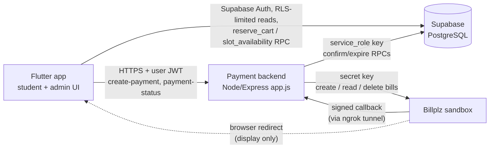
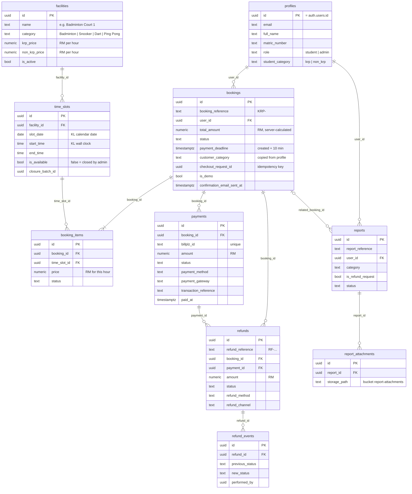
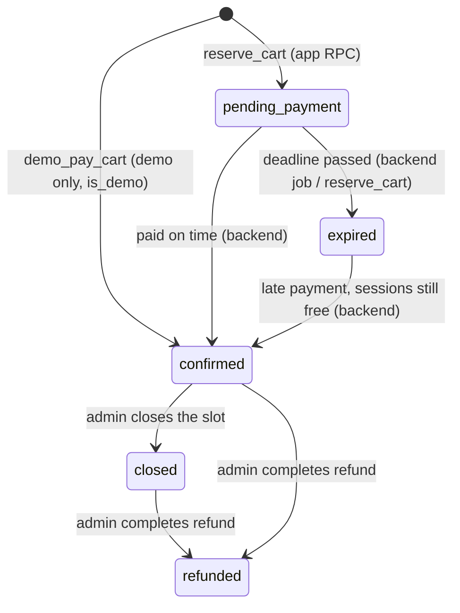
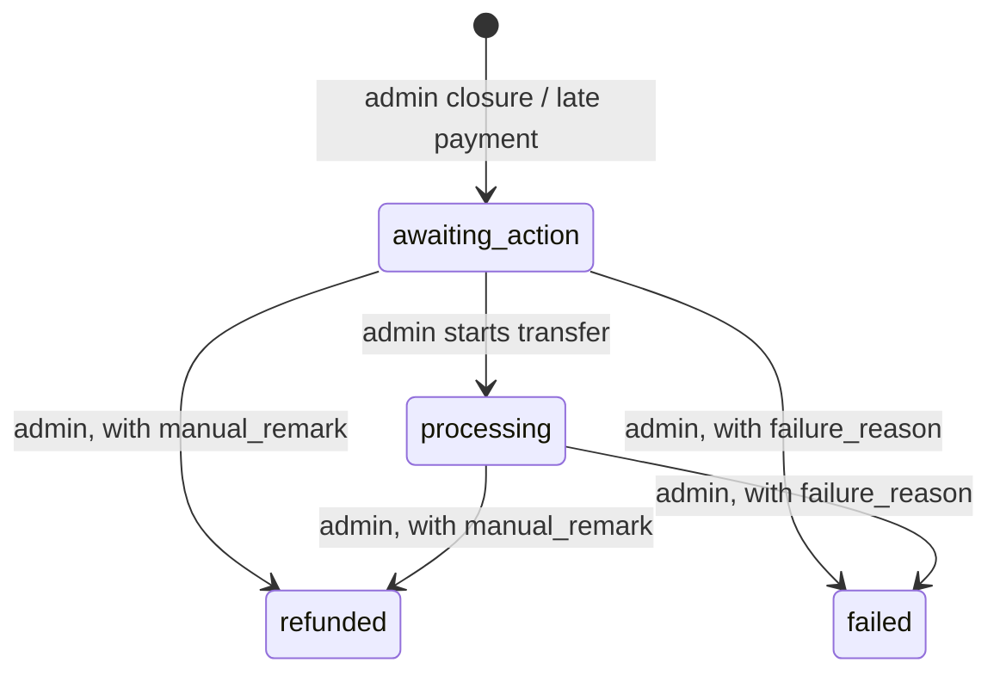

# KRP Play architecture, schema and state transitions (SCRUM-33)

This is the agreed reference for how the system is split, what each table holds,
which states a record can be in, and who is allowed to move it between states.
It documents the system **as built on `main`** (after SCRUM-80). Section 9 lists the places
where the current code does not yet follow these rules; they are open items, not hidden ones.

Related documents:
- [atomic-checkout.md](atomic-checkout.md): cart reservation in detail (SCRUM-15)
- [krp_play/backend/README.md](../krp_play/backend/README.md): running the payment backend; SCRUM-77/79/80 evidence

---

## 1. Components and responsibilities

| Part | Is responsible for | Must never |
|---|---|---|
| **Flutter app** (`krp_play/lib`) | UI, sign-in, showing availability, building the cart, calling `reserve_cart`, opening the Billplz page, showing status | Hold secret keys; set prices, categories, roles or payment success; treat the Billplz redirect as proof of payment |
| **Payment backend** (`krp_play/backend/app.js`) | Creating Billplz bills from the **stored** booking amount; verifying callbacks; confirming payments; the 2-minute reconcile job (expiry, missed callbacks, late payments) | Accept an amount from the app; expose the `service_role` key |
| **Database** (Supabase, `database/*.sql`) | Source of truth; RLS; price calculation; atomic state changes in `security definer` functions; slot uniqueness | Let `anon`/students write bookings, items or payments directly |
| **Billplz** | Taking the money; signed callback with the result | — |

**Trust rule:** anything about **money, price, category, role or payment success** is decided by the
database or the backend, never by the app.

---

## 2. Data model (ERD)

Other tables: `operating_schedules` (opening hours per day, used by `reserve_cart`) and
`facility_blocks` (management blocks; currently empty, admins close slots through
`time_slots.is_available` / `closure_batch_id` instead).

Key constraints that the rules below depend on:
- **One active claim per session:** unique index on `booking_items(time_slot_id)` where status is
  `pending_payment` or `confirmed` (`database/atomic_checkout.sql`). This is what makes double booking impossible.
- **One payment row per bill:** unique index on `payments(billplz_id)` (`database/confirm_payment.sql`).
- **One order per checkout attempt:** unique `(user_id, checkout_request_id)` (`database/atomic_checkout.sql`).

---

## 3. API contract

### 3.1 Payment backend (`krp_play/backend/app.js`)

| Method & path | Caller | Auth | Input | Output |
|---|---|---|---|---|
| `POST /api/create-payment` | App | `Authorization: Bearer <user JWT>` | `{ bookingId }` only | `200 { paymentUrl, billId }` · `401` not signed in · `404` not your booking · `409` not pending / expired |
| `GET /api/payment-status/:bookingId` | App | User JWT | — | `{ bookingStatus, paymentDeadline, lastAttempt: completed\|failed\|pending\|null }` |
| `POST /api/webhook` | Billplz | X Signature (HMAC-SHA256) | Billplz form fields | `200 OK` · `403` bad signature · `500` → Billplz retries |
| `POST /api/resend-confirmation/:bookingId` | App/admin | User JWT, owner only | — | `{ result: sent\|already_sent\|not_confirmed }` (needs SMTP, SCRUM-18) |
| `GET /payment/complete` | Browser after Billplz | none | Billplz query | HTML page, **display only** |
| `GET /health` | Anyone | none | — | `{ ok: true }` |

### 3.2 Database functions (RPC)

| Function | Called by | Grant | Does |
|---|---|---|---|
| `reserve_cart(request_id, items, expected_total)` | App | `authenticated` | Validates sessions, derives price from category, creates `pending_payment` booking + items atomically; idempotent per `request_id` |
| `slot_availability(date)` | App | `authenticated` | Per-session status (`available`, `reserved`, `booked`, `closed`, `past`) with no other customer's data |
| `demo_pay_cart(...)` | App (demo mode only) | `authenticated` | Reserve + confirm with `is_demo = true` and payment `simulated_success`. **Not in the repo** (see §9) |
| `confirm_billplz_payment(bill, cents, paid_at, ref)` | Backend | `service_role` | Locks, checks amount, records payment, confirms / late-confirms / opens refund in one transaction |
| `expire_unpaid_bookings()` | Backend job | `service_role` | Expires holds past `payment_deadline` and releases their items |

### 3.3 Direct table access from the app
Students may **read** their own `bookings`, `booking_items` and `payments` (RLS), read `facilities`,
and update only `full_name`, `phone_number` and `matric_number` on their own profile.
The student report screens insert and list the user's own `reports` (filtered by `user_id`; the `reports` RLS policies are not in the repo, see §9).
Admin screens currently read and write `bookings`, `refunds`, `refund_events`, `time_slots` and `reports`
directly through admin RLS policies (see §9).

---

## 4. Data rules

### 4.1 Identity
| Thing | Rule |
|---|---|
| User | `profiles.id` = Supabase `auth.users.id`. Created once at registration, self-only, role forced to `student` |
| Role | `student` or `admin`. Never settable from the app |
| Booking | `id` (uuid) internally; `booking_reference` = `KRP-<uuid>` shown to users and sent to Billplz |
| Payment | `billplz_id` links to the Billplz bill (unique); `transaction_reference` = Billplz transaction id. `TEST-…` = test tool, `DEMO-…` = demo mode |
| Refund | `refund_reference` = `RF-<6 chars>` (admin closure) or `RF-LATE-<8 chars>` (late payment) |

### 4.2 Category and price
- `student_category` is `krp` or `non_krp`, chosen at registration and **read-only** afterwards.
- Price per hour comes from `facilities.krp_price` / `non_krp_price`. Current rates: Badminton RM6/8, Snooker RM10/12, Dart RM3/5, Ping Pong RM4/6.
- `reserve_cart` calculates every item price and `total_amount` on the server. The app's `expected_total` is only compared, to detect price changes (`PRICE_CHANGED`); it is never stored.
- The category at booking time is copied to `bookings.customer_category`, so later profile changes do not reprice old bookings.

### 4.3 Money
- Stored as `numeric` **ringgit** (e.g. `6.00`) in `facilities`, `booking_items.price`, `bookings.total_amount`, `payments.amount`, `refunds.amount`.
- Converted to integer **cents** only at the Billplz boundary: `round(amount * 100)`. Billplz amounts (`amount`, `paid_amount`) are cents.
- A paid callback must match `round(payments.amount * 100)` exactly, or it is rejected as `amount_mismatch`.

### 4.4 Time (Asia/Kuala_Lumpur display rules)
- **Instants** (`created_at`, `paid_at`, `payment_deadline`, `updated_at`, …) are `timestamptz`, stored in UTC.
- **Sessions** are `time_slots.slot_date` + `start_time`/`end_time` = **KL wall-clock** (no time zone). One session = one hour.
- Server comparisons convert sessions to instants with `(slot_date + start_time) at time zone 'Asia/Kuala_Lumpur'`
  ("today", "is this session in the past", 30-day booking window).
- **Display rule:** every date/time shown to users is in KL time (UTC+8), formatted `d/M/yyyy` and `h:mm AM/PM`
  (e.g. `25/11/2026 9:00 PM`). Session times are shown as stored; instants must be converted to UTC+8 before display.
- Hold length is 10 minutes from reservation, enforced by `payment_deadline` on the server.

---

## 5. State dictionary and allowed transitions

"Who" = the only component allowed to make that change.

### 5.1 Booking (`bookings.status`)

| State | Meaning | Slots held? | Entered by |
|---|---|---|---|
| `pending_payment` | Reserved, 10-minute hold, waiting for Billplz | Yes | `reserve_cart` |
| `confirmed` | Paid (or demo) | Yes | `confirm_billplz_payment`, `demo_pay_cart` |
| `expired` | Hold ended without payment | No | `expire_unpaid_bookings`, `reserve_cart` |
| `closed` (stored today as `Closed (<reason>)`) | Admin closed the session; refund needed | No | Admin (`manage_slots.dart`) |
| `refunded` (stored today as `Refunded`) | Money returned | No | Admin (`refunds.dart`, `manage_slots.dart`) |

Not allowed: `expired → pending_payment` (check out again instead); `confirmed → expired`; any change by a student.

### 5.2 Booking item (`booking_items.status`)
Follows its booking: `pending_payment → confirmed | expired`, `expired → confirmed` (late, only if the session is free).
Only `pending_payment` and `confirmed` count as holding the session (unique index).

### 5.3 Payment (`payments.status`)

| State | Meaning | Entered by |
|---|---|---|
| `pending` | Billplz bill created, not paid. Stays `pending` if the bill is later deleted | Backend `create-payment` |
| `paid` | Verified by signed callback or by reading the bill from Billplz. **Final** | `confirm_billplz_payment` |
| `simulated_success` | Demo mode only, no money | `demo_pay_cart` |

`pending → paid` is the only transition. A paid payment is never undone, even if its booking cannot be honoured; a refund is opened instead.
`payment_method`: `fpx`, `touch_n_go_ewallet`. `payment_gateway`: `billplz`, `prototype_demo`.

### 5.4 Refund (`refunds.status`)

Every change writes a `refund_events` row (`previous_status`, `new_status`, `performed_by`).
Completing a refund sets the booking to `refunded`. Refunds are paid back manually (`refund_method = manual`, `refund_channel = bank_transfer`).

### 5.5 Report (`reports.status`)
`submitted → under_review → resolved | rejected` (admin). Students create reports; only admins change status.
`category`: `facility_problem`, `payment_issue`, `booking_issue`. `is_refund_request` flags refund claims.

---

## 6. Server controls price and payment success

| Rule | Where it is enforced | Evidence |
|---|---|---|
| App cannot set the price | `reserve_cart` derives price from category + `facilities` | `database/tests/checkout.test.mjs` (price tampering) |
| App cannot set the amount paid | `create-payment` reads `bookings.total_amount`; only `bookingId` is accepted | SCRUM-77 (backend README) |
| App cannot mark anything paid | No student write grants on `bookings`/`booking_items`/`payments` | `database/atomic_checkout.sql` grants |
| Only Billplz can confirm | X Signature + collection + amount checks, then `confirm_billplz_payment` | SCRUM-79 tests (`scripts/fake-callback.js`) |
| Redirect is not proof | `/payment/complete` only displays a message | `app.js` |
| Late payment cannot take someone else's session | Unique active-slot index; refund opened instead | SCRUM-80 |

---

## 7. Migrations

Supabase CLI migrations are **not** set up yet. Schema changes are reviewed SQL files in `database/`,
run by hand in **Supabase → SQL Editor**, in this order:

| Order | File | Re-runnable? |
|---|---|---|
| 1 | `database/atomic_checkout.sql` | **No**: one-time; aborts on legacy data (see atomic-checkout.md) |
| 2 | `database/confirm_payment.sql` | Yes (`create or replace`, `if not exists`) |

Rules for new changes:
1. Write the change as a new file in `database/`, named after what it does, with the Jira key in a comment.
2. Prefer re-runnable SQL (`if not exists`, `create or replace`).
3. Commit the file **in the same PR** as the code that needs it, and say in the PR that it must be run.
4. Never change tables only in the dashboard. Several existing objects exist only in Supabase (see §9).
5. When the team adopts the Supabase CLI, copy these files into `supabase/migrations/` in the same order.

## 8. Test data

| Level | Approach |
|---|---|
| Database | `database/tests/checkout.test.mjs` + `fixture.sql` build a minimal schema in an **empty, disposable** PostgreSQL database and test checkout with two connections. It refuses to run on a non-empty database. Never point it at the hosted project. |
| Backend | Manual, against the Billplz **sandbox** only: real sandbox payments plus `krp_play/backend/scripts/fake-callback.js` for signed fake callbacks (bad signature, wrong amount, repeats, late). Rows made this way have `transaction_reference` starting with `TEST-`. |
| App | `flutter test` widget tests with a fake `BookingService` (`test/support/checkout_fake.dart`); no network. |
| Demo data | Demo-mode bookings have `is_demo = true` and payments `simulated_success` / `DEMO-…`. Exclude them from real reports. |
| Accounts | Use dedicated test student accounts (one `krp`, one `non_krp`) and one admin. Never use real student data in tests. |

---

## 9. Open items (not yet following the rules above)

These are known gaps, recorded so the team can agree how to fix them. None is fixed by this document.

| # | Gap | Proposal |
|---|---|---|
| 1 | Booking statuses are mixed case: `Closed (Maintenance)`, `Refunded` vs `confirmed`, `expired` | Store lowercase `closed` / `refunded`; keep the reason in `admin_note` |
| 2 | Admin screens write `bookings`, `refunds`, `refund_events` directly from Flutter | Move these changes into backend endpoints or `security definer` functions, as `atomic-checkout.md` intends |
| 3 | `demo_pay_cart`, `refunds`, `refund_events`, `reports`, `report_attachments` and `bookings.confirmation_email_sent_at` exist only in Supabase, not in `database/` | Export their SQL into `database/` files |
| 4 | Flutter shows instants with `toLocal()`, i.e. in the **device's** time zone | Convert to UTC+8 explicitly in one shared formatter |
| 5 | `payments.payment_method` is always `fpx` for Billplz | Read the real method from Billplz transactions |
| 6 | `bookings.facility_name`, `booking_date`, `start_time` duplicate data that lives in `booking_items → time_slots` (used by admin closures) | Use items/slots only, then drop the columns |
| 7 | Deleted Billplz bills stay `pending` in `payments` | Add a `cancelled` payment status |
| 8 | 5 widget tests in `atomic_checkout_test.dart` fail since `FacilitiesScreen` uses `Supabase.instance` directly (SCRUM-43) | Inject the Supabase client so tests can fake it |
| 9 | `facility_blocks` is unused while admins close slots via `time_slots` | Choose one mechanism |
